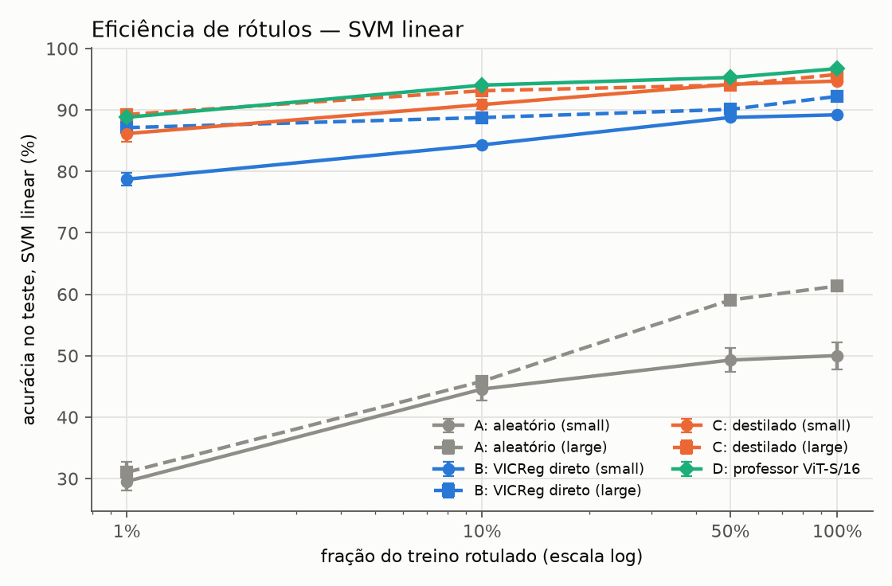
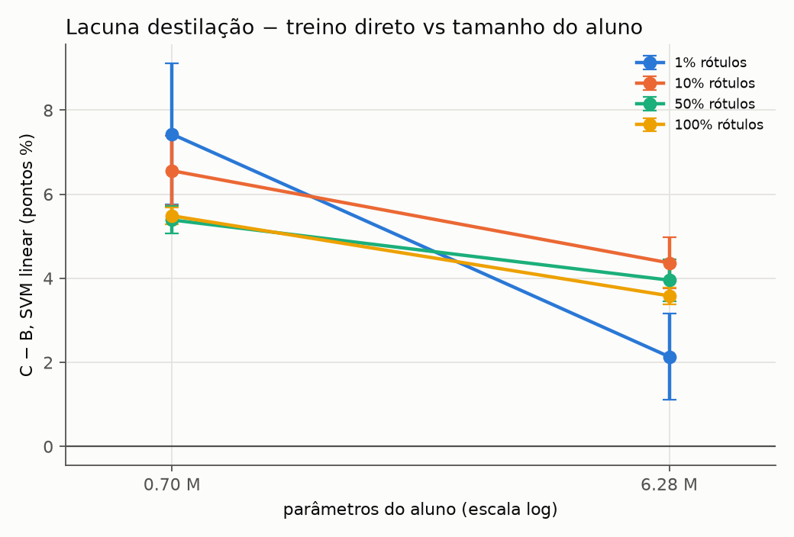
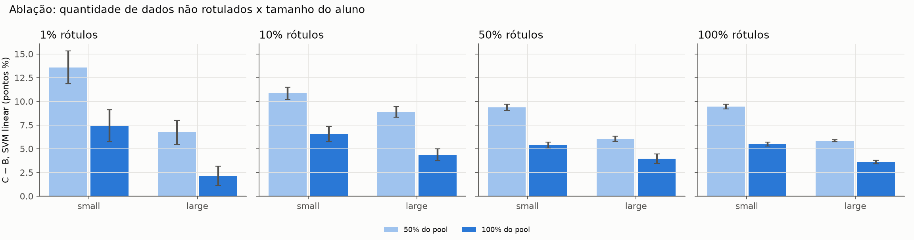
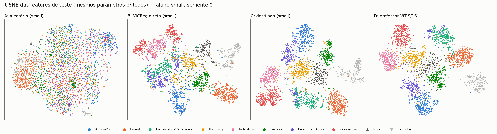

# MO433 — Destilando representações não supervisionadas em modelos pequenos

Implementação do projeto final de MO433 (*"Distilling Unsupervised Representations into Small
Models"*, A. X. Falcão, 2026). O repositório faz um teste **controlado e com orçamento casado** da
hipótese:

> Destilar um ViT auto-supervisionado congelado (DINO ViT-S/16) numa convnet pequena (**C**) é melhor
> do que treinar a mesma convnet diretamente com um objetivo auto-supervisionado (**B**, VICReg)?

| # | Encoder | Papel |
|---|---|---|
| **A** | aluno com pesos aleatórios (sem treino) | linha de base |
| **B** | aluno treinado do zero com **VICReg** (lightly) | a comparação |
| **C** | o mesmo aluno, **destilado** do professor congelado (cosseno) | o pipeline proposto |
| **D** | o professor **DINO ViT-S/16**, congelado | teto e referência de custo |

Tudo — dados, treinos, sondas, diagnósticos, tabelas e figuras — é regenerado do zero por um único
comando (seção [Como reproduzir](#como-reproduzir)). Cada etapa grava um log completo com horário em
`results/<dataset>/logs/`.

---

## Sumário

1. [Como reproduzir](#como-reproduzir)
2. [Estrutura do repositório](#estrutura-do-repositório)
3. [Etapas seguidas](#etapas-seguidas)
4. [Decisões de projeto (e por quê)](#decisões-de-projeto-e-por-quê)
5. [Resultados (EuroSAT)](#resultados-eurosat)
6. [Análise](#análise)
7. [Limitações e ressalvas](#limitações-e-ressalvas)
8. [Trabalhos relacionados e referências](#trabalhos-relacionados-e-referências)

---

## Como reproduzir

### Ambiente

Testado em Windows 11, Python 3.13, PyTorch 2.11 + CUDA 12.8, GPU **RTX 4060 (8 GB)**, CPU Ryzen 5 5500
(12 threads), 16 GB de RAM.

```bash
python -m venv .venv
# Windows: .venv\Scripts\activate    |  Linux/macOS: source .venv/bin/activate
pip install torch torchvision --index-url https://download.pytorch.org/whl/cu128
pip install -r requirements.txt
pip install -e . --no-deps          # instala o pacote mo433_projeto_final (src/)
```

### Comandos

```bash
# 0) teste de fumaça: o pipeline inteiro em dados sintéticos (~5 min) — rode antes de gastar GPU
bash scripts/smoke_test.sh

# 1) estudo completo (retomável: execuções já concluídas são puladas)
bash scripts/run_all.sh eurosat              # Linux / Git Bash
.\scripts\run_all.ps1 -Dataset eurosat       # PowerShell
EPOCHS=100 bash scripts/run_all.sh eurosat   # configuração usada nos resultados abaixo

# ... ou etapa por etapa
python -m mo433_projeto_final prepare   --dataset eurosat --epochs 100
python -m mo433_projeto_final teacher   --dataset eurosat
python -m mo433_projeto_final benchmark --dataset eurosat
python -m mo433_projeto_final tune      --dataset eurosat
python -m mo433_projeto_final train-all --dataset eurosat
python -m mo433_projeto_final evaluate  --dataset eurosat --n-jobs 4
python -m mo433_projeto_final report    --dataset eurosat

# uma execução isolada
python -m mo433_projeto_final train --dataset eurosat --row C --size large --seed 1 --data-frac 0.5
```

O STL-10 também é suportado (`--dataset stl10`, 96 px, 20k imagens não rotuladas, K=6 views).

### O que cada comando produz (`results/<dataset>/`)

| Arquivo | Conteúdo | Seção do enunciado |
|---|---|---|
| `config.json` | configuração efetiva do estudo (lida por todas as etapas) | — |
| `label_subsets.pkl` | subconjuntos rotulados (4 frações × 3 sorteios), gerados **uma vez** | 3.1 |
| `teacher_sanity.json` | k-NN, std dos embeddings, NMI/ARI do professor | 3.3 |
| `teacher_cost.json` | GPU-horas do professor (cache das views) + custo de pré-treino publicado | 3.4, 6 |
| `benchmark.json` | vazão (loader, passo B/C, professor), parâmetros, FLOPs, latência, projeção de tempo | 2.1, 3.9 |
| `tuning.json` | grade de lr para B e C (mesma grade, mesmo esforço) | 3.6 |
| `runs/<execução>/` | `history.csv` (perda/época), `summary.json` (tempo, checagem de colapso), `checkpoint.pt` | 3.4, 3.5 |
| `probe_hparams.json` | C / gamma escolhidos uma vez por CV e congelados | 3.6 |
| `probe_results.csv` | uma linha por encoder × semente × fração × sorteio × sonda | 3.6 |
| `results_table.csv` | tabela agregada (média ± desvios) + parâmetros, FLOPs e latência | 3.8 |
| `gap_table.csv` | lacuna C − B com *spread* e veredito (conclusivo ou não) | 6 |
| `ablation_grid.csv` | grade da ablação (dados não rotulados × tamanho) | 5 |
| `diagnostics.csv`, `diagnostics_table.csv` | k-means NMI/ARI e std dos embeddings | 3.7 |
| `cost_table.csv` | GPU-horas e ganho por GPU-hora | 6 |
| `fig_label_efficiency.png` | **figura principal**: curva de eficiência de rótulos (SVM linear) | 3.8 |
| `fig_label_efficiency_all_probes.png` | as três sondas | 3.8 |
| `fig_gap_vs_params.png` | lacuna C − B vs nº de parâmetros | 6 (5) |
| `fig_ablation.png` | grade da ablação | 5 |
| `fig_tsne_small.png`, `fig_tsne_large.png` | painéis de quatro projeções t-SNE (A, B, C, D) | 3.7 |
| `fig_training_curves.png` | perda e std das features por época (B e C) | 3.4 |
| `summary.md` | todas as tabelas acima em Markdown | — |
| `logs/*.log`, `logs/runs/*.log` | log de cada etapa e de cada treino | — |

---

## Estrutura do repositório

```
src/mo433_projeto_final/
├── __main__.py     CLI: etapas prepare / teacher / benchmark / tune / train(-all) / evaluate / report / all
├── config.py       configuração única do estudo (orçamento compartilhado por B e C)
├── utils.py        logging (console + arquivo), sementes, cronômetro de GPU-horas, JSON
├── data.py         datasets, splits, subconjuntos rotulados, transformações de treino/avaliação, K views
├── models.py       família de alunos (projeto próprio), professor timm, projetores
├── teacher.py      linha D, checagem de sanidade, cache das features do professor
├── train.py        laço de treino comum: B (VICReg) e C (destilação por cosseno)
├── tune.py         grade simétrica de learning rate para B e C
├── features.py     a ÚNICA função de extração de features (usada para A, B, C e D)
├── probes.py       k-NN, SVM linear, SVM RBF (pré-processamento e hiperparâmetros idênticos)
├── diagnostics.py  std dos embeddings, k-means (NMI/ARI), checagem de colapso, t-SNE
├── benchmark.py    vazão, parâmetros, FLOPs, latência
├── evaluate.py     orquestra features + sondas + diagnósticos para todos os encoders
└── report.py       tabelas, figuras e summary.md
scripts/            run_all.sh, run_all.ps1, smoke_test.sh
results/            saídas (tabelas, figuras, logs; arquivos grandes ficam fora do git)
```

---

## Etapas seguidas

A ordem segue o cronograma da Seção 7 do enunciado.

1. **Leitura do enunciado e escolha do dataset** → EuroSAT (ver decisões).
2. **Pipeline de dados** (`prepare`): download, divisão estratificada 80/20 fixa, pool não rotulado
   (rótulos descartados), subconjuntos rotulados gerados uma vez, K=8 views aumentadas por imagem.
3. **Professor e linha D** (`teacher`): carregamento do checkpoint público, **checagem de sanidade**
   (k-NN 95,5%, std/ref 0,75, NMI 0,76 → aprovado) e cache das 8 × 21 600 features do professor.
4. **Medida de vazão** (`benchmark`): DataLoader com aumento, passo de B e C por tamanho, forward do
   professor; parâmetros, FLOPs e latência; projeção do tempo total → escolha de 100 épocas.
5. **Teste de fumaça** (`smoke`): o pipeline inteiro em dados sintéticos antes de gastar GPU. Ele
   revelou (e permitiu corrigir) um bug no gerador sintético cujos rótulos de treino e teste não
   correspondiam — precisamente o tipo de erro que a checagem "k-NN abaixo do acaso" existe para pegar.
6. **Ajuste simétrico** (`tune`): mesma grade de lr para B e C, avaliada por k-NN numa validação
   tirada do treino.
7. **Treinos B e C** (`train-all`): 10 execuções do estudo principal + 10 da ablação, com checagem
   de colapso (k-NN, std, k-means) ao fim de cada uma.
8. **Avaliação** (`evaluate`): linha A, hiperparâmetros das SVMs escolhidos uma vez, sondas em
   4 frações × 3 sorteios para 26 encoders, k-means e t-SNE.
9. **Relatório** (`report`): tabelas, figuras, análise de custo.

---

## Decisões de projeto (e por quê)

### Dataset: EuroSAT como experimento principal

* O enunciado (Seção 4.2) exige usar um dataset **fora do ImageNet** como principal, ou discutir o
  viés do STL-10. O professor DINO foi pré-treinado no ImageNet-1k; STL-10/Imagenette favoreceriam
  C e D. O **EuroSAT** (imagens de satélite Sentinel-2, RGB, 27 000 imagens 64×64, 10 classes) está
  fora do ImageNet e é um domínio onde modelos pré-treinados transferem pior, o que torna a pergunta
  mais interessante.
* 21 600 imagens no pool não rotulado estão dentro da faixa de 10k–30k sugerida.
* **Splits** (o EuroSAT não tem split oficial): divisão estratificada fixa 80/20 (semente 0).
  - pré-treino (B) e destilação (C): as 21 600 imagens de treino **sem rótulos** (o array de treino
    das redes nem contém os rótulos);
  - sondas: as mesmas 21 600 imagens de treino, **com rótulos**, nas frações 1/10/50/100%;
  - teste: 5 400 imagens, nunca usadas em pré-treino, destilação ou ajuste das sondas.
  As imagens de pré-treino e das sondas se sobrepõem — prática padrão em SSL e sem vazamento, pois
  nenhum rótulo é usado no pré-treino.

### Professor (linha D)

* `timm: vit_small_patch16_224.dino` = checkpoint oficial `dino_deitsmall16` (Caron et al., 2021),
  ViT-S/16, **21,7 M parâmetros**, pré-treinado sem rótulos no ImageNet-1k (800 épocas). É o padrão
  recomendado e cabe numa GPU modesta.
* **Pooling**: token CLS (`num_classes=0`, `global_pool="token"`), dim. 384 — a mesma feature usada
  nas avaliações k-NN/linear do DINO. A mesma receita é usada em todas as sondas.
* **Entrada**: as imagens de 64 px são ampliadas (bicúbico) para **224 px** e normalizadas com as
  estatísticas do ImageNet — um ViT com patch 16 precisa de ~224 px.
* Sempre em `eval()`, `torch.no_grad()` e `autocast(fp16)`.
* **Custo de pré-treino publicado**: o README oficial do DINO reporta 1,75 dia em 8 GPUs (V100) para
  100 épocas de ViT-S/16 ⇒ 336 GPU-h/100 épocas; extrapolado para as 800 épocas do checkpoint:
  **≈ 2 688 GPU-h** (estimativa, provavelmente um limite inferior; está em `config.py`).

### Aluno: família de convnets residuais (projeto próprio)

`StudentNet` (`models.py`) — backbone sem cabeça, saída = *global average pooling*:

| Componente | Escolha | Justificativa |
|---|---|---|
| Blocos | residuais básicos (conv3×3-BN-ReLU-conv3×3-BN + atalho) | treinam de forma estável a partir de inicialização aleatória sob dois objetivos muito diferentes (VICReg e cosseno); convs densas 3×3 são mais rápidas em GPU que depthwise-separáveis nestas larguras pequenas (estas são limitadas por memória) |
| Profundidade | 4 estágios × 2 blocos | esqueleto de uma ResNet-18; a profundidade é fixa para que só a largura varie entre tamanhos |
| Stem | 1 conv 3×3, stride 2, **sem max-pool** | o stem do ImageNet (7×7/2 + max-pool, redução 4×) destruiria detalhes em 64 px (Seção 4.3); reduzindo só 2× preservamos textura, importante em imagens de satélite |
| Downsampling | conv 3×3 com stride 2 no 1º bloco dos estágios 2–4, atalho 1×1/2 | mapa final = entrada/16 = 4×4 a 64 px (6×6 a 96 px): ainda há resolução espacial antes do pooling |
| Normalização / ativação | BatchNorm + ReLU | a combinação mais simples e testada com VICReg e destilação |
| Inicialização | Kaiming (fan_out), BN peso 1 / viés 0, sem zero-init | A, B e C com a mesma semente partem **exatamente dos mesmos pesos** |
| Regra de escala | **só o multiplicador de largura** *m* sobre (32, 64, 128, 256), arredondado a múltiplos de 8 | uma única regra de escala: a comparação entre tamanhos não é confundida por outras mudanças |

| Variante | *m* | Larguras | Parâmetros | GFLOPs/img @64px | Dim. | Latência GPU (b256, fp16) | Latência CPU (b1) |
|---|---|---|---|---|---|---|---|
| small | 0,5 | 16-32-64-128 | **0,70 M** | 0,070 | 128 | 0,014 ms/img | 2,5 ms |
| large | 1,5 | 48-96-192-384 | **6,28 M** | 0,626 | 384 | 0,057 ms/img | 7,5 ms |
| professor | — | ViT-S/16 | **21,67 M** | 9,197 @224px | 384 | 0,58 ms/img | 47 ms |

O professor é 3,4× maior que o maior aluno (31× maior que o menor) e custa 15–130× mais FLOPs.
Os dois alunos estão na faixa de 0,5–10 M parâmetros recomendada. Latência medida na RTX 4060, após
10 iterações de aquecimento e com média de 50 batches (CPU: batch 1, fp32, média de 20).

### Linha B: VICReg (lightly)

* É o padrão sugerido pelo enunciado para uma GPU modesta: sem negativos, sem EMA, robusto a batches
  pequenos e pouco propenso a colapso. DINO-convnet (o mesmo método do professor) seria mais limpo,
  mas é mais caro e colapsa facilmente abaixo de ~96 px — inadequado para 64 px.
* Perda `lightly.loss.VICRegLoss` (λ=25, μ=25, ν=1) e projetor `VICRegProjectionHead` de 3 camadas
  (2048-2048-2048; o original usa 8192, reduzido por custo). Os componentes invariância / variância /
  covariância são registrados no log por época.
* **Ressalva** (Seção 2.1): com professor DINO e B = VICReg, C vs B difere em **duas** coisas — a fonte
  da supervisão (professor congelado vs objetivo próprio) **e** o objetivo (cosseno vs VICReg). A
  lacuna não pode ser atribuída só à destilação.

### Linha C: destilação

* Exatamente o laço da Seção 3.5: `1 − cos(projetor(aluno(view)), professor(view))`, projetor
  Linear(d, 2048)-BN-GELU-Linear(2048, 384), descartado após o treino. Sem rótulos, sem logits.
* Aluno e professor veem **a mesma view aumentada** (64 px para o aluno, a mesma imagem ampliada a
  224 px para o professor).

### Orçamento casado entre B e C (Seção 3.4)

B e C chamam **o mesmo laço** (`train.train_student`) e leem os mesmos campos da configuração:

| | B | C |
|---|---|---|
| arquitetura e inicialização | idênticas (`build_student(size, seed)`) | idênticas |
| pool de imagens, K views | idênticos | idênticos |
| épocas / passos / batch | 100 / 8 400 / 256 (pool 100%) | 100 / 8 400 / 256 |
| otimizador | AdamW, wd 0,05 (sem wd em BN/viés), warm-up 3 épocas + cosseno | idem |
| precisão | bf16 autocast, `channels_last`, perda em fp32 | idem |
| views por imagem por passo | 2 (o VICReg compara duas views) | 1 (a mesma dada ao professor) |

**Ajuste de hiperparâmetros simétrico** (`tune.py`): a mesma grade lr ∈ {5e-4, 1e-3, 2e-3} para B e C,
mesmo protocolo (aluno small, semente 0, 25 épocas), mesmo critério (k-NN numa validação de 20%
tirada do *treino* rotulado — o teste nunca é usado). Cada linha usa o seu lr vencedor (ver
resultados). Projetor e épocas não foram ajustados para nenhuma das duas.

### K views pré-geradas e cache do professor (Seção 3.9)

* A transformação de treino (`lightly.transforms.VICRegViewTransform`: RandomResizedCrop, flip,
  color jitter, grayscale, blur, solarização) é aplicada **uma vez**, K=8 vezes por imagem, e salva
  como `uint8` (21 600 × 8 × 64×64×3 = 2,1 GB). A cada época, B sorteia 2 views distintas das 8 (28
  pares possíveis) e C sorteia 1.
* `min_scale = 0,2` (o padrão do lightly, 0,08, gera recortes sem conteúdo em 64 px). Nenhum outro
  parâmetro do lightly foi alterado (não ajustamos o aumento para favorecer nenhuma linha).
* Vantagens: (1) o DataLoader deixa de ser gargalo (3 400 img/s com 6 workers vs 4 500–18 000 img/s
  dos passos de treino); (2) o custo do professor vira um custo único (**105 s, 0,029 GPU-h** para
  172 800 views) compartilhado por todas as sementes, tamanhos e pela ablação, e cobrado de C na
  análise de custo; (3) B e C veem exatamente os mesmos aumentos.
* Custo: um conjunto finito de aumentos é mais fraco que aumento *on-the-fly* — para as duas linhas
  igualmente.

### Sondas (Seção 3.6)

* Features extraídas **uma vez** por encoder com a transformação determinística e salvas em disco.
* Pré-processamento idêntico: L2-normalização + `StandardScaler` ajustado **só** no subconjunto de
  treino.
* **k-NN**: cosseno, k = min(20, n_por_classe), com n_por_classe = tamanho da menor classe do
  subconjunto (k = 16 a 1% de rótulos, k = 20 nas demais frações). Regra fixa, não ajustada.
* **SVM linear** (`LinearSVC`) e **SVM RBF** (`SVC`): C e (C, gamma) escolhidos **uma vez** por CV de
  3 folds no treino, no encoder B/small/seed 0/100% rótulos, e **congelados** para todos os encoders.
  Gamma é congelado como multiplicador de 1/d (o "scale" do scikit-learn), pois os encoders têm
  dimensões diferentes (128 vs 384).
* SVM RBF subamostrado (estratificado) para **10 000** exemplos a 50% e 100% de rótulos
  (10 800 e 21 600 exemplos).
* Encoders **congelados** o tempo todo; linha A extraída com **BatchNorm em `eval()` com as
  estatísticas default** (média 0, variância 1), logo as features não dependem do batch.

### Sementes e estatística

* Aluno small: **3 sementes** (0, 1, 2); large: **2 sementes** (0, 1) — para A, B e C.
* 3 sorteios independentes de subconjunto rotulado por fração (estratificados, `random_state=draw`).
* `std_all` = desvio sobre semente × sorteio (inclui a variância de *quais* imagens são rotuladas);
  lacuna C − B *conclusiva* só se |gap| > √(std_B² + std_C²). Para o aluno large (2 sementes) as
  execuções individuais também são mostradas.

### Ablação (Seção 5): quantidade de dados não rotulados

Escolhida porque é "o teste mais direto da hipótese" (cruza dados com tamanho do aluno): **50% vs
100%** do pool, mesmas épocas (logo metade dos passos — a redução de orçamento é real), nos dois
tamanhos, com as mesmas sementes e sondas. O subconjunto de 50% é o mesmo para B, C e todas as
sementes. **Expectativa** (hipótese do enunciado): com menos dados a vantagem de C (alvo denso dado
pelo professor) deveria crescer, principalmente no aluno pequeno.

### Logging e rastreabilidade

* `utils.setup_logging`: cada etapa escreve `results/<ds>/logs/<etapa>.log` (horário, nível, módulo)
  e cada treino também `logs/runs/<execução>.log`; a linha de comando, o hardware e a configuração
  completa são registrados no início de cada etapa.
* Por época: perda (e componentes do VICReg), lr, std das features do backbone (monitor de colapso),
  tempo. Ao fim: GPU-horas, pico de memória, checagem de colapso.
* Todas as etapas são idempotentes: nada já calculado é recalculado silenciosamente
  (`label_subsets.pkl` nunca é regenerado; execuções concluídas são puladas).

---

## Resultados (EuroSAT)

Configuração final: EuroSAT, 21 600 imagens não rotuladas a 64 px, K = 8 views, **100 épocas**, batch
256, AdamW lr = 2e-3 (B e C), 3 sementes (small) / 2 sementes (large), 3 sorteios de rótulos por fração.
Valores = acurácia no teste (%), média ± desvio sobre semente × sorteio. A versão completa (incluindo a
ablação e os diagnósticos) está em [`results/eurosat/summary.md`](results/eurosat/summary.md).

**Checagens.** Professor aprovado (k-NN 95,5%, NMI 0,76, std/ref 0,75). **20/20 treinos aprovados**
na checagem de colapso (k-NN ≫ acaso, std/ref ≥ 0,54, NMI ≥ 0,55). Ajuste de lr: B e C escolheram
2e-3 (k-NN de validação: B 73,2 / 75,5 / 79,5%; C 81,6 / 86,5 / 90,0% para 5e-4 / 1e-3 / 2e-3).
Hiperparâmetros das sondas congelados (CV em B/small/seed 0): C linear = 1, C RBF = 1, γ = 1/d.

### Tabela principal — SVM linear

| Encoder | params | 1% rótulos | 10% | 50% | 100% |
|---|---|---|---|---|---|
| A: aleatório (small) | 0,70 M | 29,5 ± 1,5 | 44,6 ± 1,8 | 49,3 ± 2,0 | 50,0 ± 2,2 |
| A: aleatório (large) | 6,28 M | 31,0 ± 1,7 | 45,8 ± 0,7 | 59,1 ± 0,7 | 61,3 ± 0,8 |
| B: VICReg (small) | 0,70 M | 78,7 ± 1,1 | 84,3 ± 0,3 | 88,8 ± 0,2 | 89,2 ± 0,1 |
| B: VICReg (large) | 6,28 M | 87,1 ± 0,6 | 88,8 ± 0,5 | 90,1 ± 0,4 | 92,2 ± 0,1 |
| C: destilado (small) | 0,70 M | 86,2 ± 1,3 | 90,9 ± 0,8 | 94,2 ± 0,3 | 94,7 ± 0,2 |
| C: destilado (large) | 6,28 M | **89,3 ± 0,8** | 93,1 ± 0,3 | 94,1 ± 0,3 | 95,8 ± 0,1 |
| D: professor ViT-S/16 | 21,67 M | 88,8 ± 0,7 | **94,0 ± 0,1** | **95,3 ± 0,2** | **96,7 ± 0,0** |

Tabelas de k-NN e SVM RBF (mesmo ordenamento A < B < C ≲ D; o SVM RBF fica igual ou acima do linear, com o maior ganho a 1% de rótulos — ex.: B small 78,7 → 83,1, C small 86,2 → 89,3):
ver `summary.md`. Latências e FLOPs: tabela na seção [Aluno](#aluno-família-de-convnets-residuais-projeto-próprio).



### Lacuna C − B (SVM linear, pontos percentuais; *spread* = √(std_B² + std_C²))

| Aluno | 1% | 10% | 50% | 100% |
|---|---|---|---|---|
| small (0,70 M) | **+7,4** ± 1,7 | **+6,6** ± 0,8 | **+5,4** ± 0,3 | **+5,5** ± 0,2 |
| large (6,28 M) | **+2,1** ± 1,0 | **+4,4** ± 0,6 | **+4,0** ± 0,5 | **+3,6** ± 0,2 |

Todas as 24 células (2 tamanhos × 4 frações × 3 sondas) dão C > B; **23 são conclusivas**
(|gap| > spread). A única inconclusiva: aluno large, 1% de rótulos, k-NN (+0,4 ± 1,1). No aluno large
as duas sementes de C ficam acima das duas de B em todas as frações (tabela de execuções individuais
no `summary.md`), mas com só 2 sementes a conclusão nesse tamanho é mais cautelosa.



### Ablação — quantidade de dados não rotulados (SVM linear)

| Aluno | rótulos | B 100% → 50% do pool | C 100% → 50% do pool | C − B (pool 100%) | C − B (pool 50%) |
|---|---|---|---|---|---|
| small | 1% | 78,7 → 70,9 | 86,2 → 84,5 | +7,4 ± 1,7 | **+13,6 ± 1,7** |
| small | 100% | 89,2 → 83,4 | 94,7 → 92,8 | +5,5 ± 0,2 | **+9,4 ± 0,3** |
| large | 1% | 87,1 → 81,3 | 89,3 → 88,0 | +2,1 ± 1,0 | **+6,7 ± 1,3** |
| large | 100% | 92,2 → 89,1 | 95,8 → 94,9 | +3,6 ± 0,2 | **+5,8 ± 0,1** |

Com metade do pool (e, portanto, metade dos passos), **B perde 3–8 pontos e C perde só 1–2**. A
lacuna C − B aumenta nos dois tamanhos e em todas as frações de rótulos (grade completa em
`ablation_grid.csv`): o efeito do fator ablado vai **na mesma direção para os dois tamanhos** e é
maior no aluno pequeno — sem interação de sinal, só de magnitude.



### Representações (k-means no teste, k = 10) e t-SNE

| | A small | A large | B small | B large | C small | C large | D |
|---|---|---|---|---|---|---|---|
| NMI | 0,23 | 0,25 | 0,64 | 0,70 | 0,74 | **0,78** | 0,76 |
| ARI | 0,14 | 0,16 | 0,55 | 0,64 | 0,68 | 0,70 | **0,71** |
| std/ref | 0,11 | 0,09 | 0,64 | 0,72 | 0,54 | 0,59 | 0,75 |



### Custo

| | GPU-h nesta máquina (RTX 4060) |
|---|---|
| um treino B small / large (100 épocas) | 0,15 / 0,27 |
| um treino C small / large (100 épocas) | 0,05 / 0,10 |
| cache do professor (172 800 views, uma única vez) | 0,03 |
| **estudo inteiro** (20 treinos + cache) | **2,06** |
| pré-treino publicado do professor (V100, estimativa) | ≈ 2 688 |

C foi **mais barato** que B no orçamento do aluno (1 view por passo e projetor menor vs 2 views e
o projetor 2048-2048-2048 do VICReg), mesmo cobrando o cache do professor.

---

## Análise

Todas as conclusões abaixo valem para **B = VICReg**, EuroSAT a 64 px, 100 épocas e 21,6k imagens.

**1. A destilação vence o treino direto? Em que fração de rótulos a resposta muda?**
Sim, em todas as frações e nos dois tamanhos, por diferenças muito maiores que o spread entre
sementes e sorteios (ex.: +5,5 ± 0,2 pts no small a 100%). A resposta **não muda** de sinal com a
fração de rótulos; muda a magnitude: no aluno small a vantagem é maior com poucos rótulos (+7,4 a 1%
vs +5,5 a 100%). No aluno large, a 1% de rótulos a vantagem encolhe para +2,1 (linear) e deixa de ser
conclusiva no k-NN — é o único ponto onde B "quase alcança" C. A linha A (50–61% a 100%, longe do
acaso de 10%, confirmando que uma rede aleatória já é um extrator razoável) mostra que o ganho de C não é
"qualquer pré-treino ajuda": B também ganha ~30–40 pontos sobre A, e C ainda ganha 4–7 sobre B.

**2. Quanto do professor sobrevive à compressão (C vs D)?**
Muito. A 100% de rótulos, o C small retém **98%** da acurácia linear do professor (94,7 vs 96,7) com
**3% dos parâmetros**, **131× menos FLOPs**, latência de GPU **42× menor** e de CPU (batch 1) **19×
menor**. O C large retém **99%** (95,8 vs 96,7) com 29% dos parâmetros e 15× menos FLOPs, e a 1% de
rótulos chega a ficar **acima** do professor no SVM linear (89,3 vs 88,8, dentro do spread) — as
features de 384-d do aluno, treinadas em EuroSAT, são mais fáceis de separar linearmente com poucos
exemplos que as do ViT. No SVM RBF o professor mantém ~1 ponto de vantagem.

**3. O desvio pelo professor valeu a pena?**
Depende de quem paga o pré-treino. **Localmente**, C é ao mesmo tempo melhor e mais barato que B
(0,05 vs 0,15 GPU-h no small, mesmo somando as 0,03 GPU-h do cache do professor): para quem baixa um
checkpoint público, a destilação domina. **Contando o pré-treino publicado** (≈ 2 688 GPU-h V100), o
ganho é de ~0,002 pontos por GPU-hora extra — o desvio só se justifica porque esse custo já foi pago
uma vez e é amortizado por todos os usuários do checkpoint. Para alguém que precisasse pré-treinar o
professor só para este problema, gastar uma fração desse orçamento treinando B por mais tempo ou com
mais dados seria muito mais eficiente.

**4. Os diagnósticos não supervisionados concordam com as sondas?**
Em geral sim (A < B < C ≈ D em NMI e em acurácia), com duas divergências instrutivas:
* **C large tem NMI maior que o professor** (0,78 vs 0,76) embora tenha acurácia linear menor (95,8
  vs 96,7). A destilação por cosseno em 64 px parece "comprimir" o espaço em aglomerados mais
  compactos (std/ref menor: 0,59 vs 0,75 — menos dimensões efetivamente usadas), o que ajuda o
  k-means mas tira um pouco da informação fina que o SVM explora.
* **C small e C large têm acurácia linear quase igual a 50% de rótulos (94,2 vs 94,1) mas NMI
  diferente (0,74 vs 0,78)**: o aluno maior organiza melhor as classes de forma *global* (clusters
  isotrópicos), enquanto o menor é igualmente separável por um hiperplano, mas com classes menos
  compactas. Acurácia de sonda mede separabilidade; NMI mede agrupamento natural — não são a mesma coisa.
* A linha A tem std/ref ≈ 0,1 (features altamente correlacionadas, quase "colapsadas" em direção) e
  mesmo assim 50–61% no SVM linear: o diagnóstico de std sozinho não mede utilidade.

**5. A lacuna C − B muda com o tamanho do aluno?**
Sim: **diminui** do small para o large em todas as frações (100% de rótulos: +5,5 → +3,6; 1%:
+7,4 → +2,1), como a hipótese prevê (`fig_gap_vs_params.png`). **B não ultrapassa C** em nenhum dos dois
tamanhos testados; extrapolar o ponto de cruzamento a partir de dois pontos seria especulação — um
aluno ainda maior (ou mais épocas/dados) seria o próximo experimento. A ablação reforça a leitura:
menos dados aumentam a lacuna (B é *data-hungry*, C recebe um alvo denso por imagem), e o efeito é
maior no aluno pequeno.

**6. Orçamento curto.** 100 épocas em 21,6k imagens é um regime de pouco treino para o VICReg (a perda
de B ainda caía no fim; ver `fig_training_curves.png`) e a ablação mostra que B é o mais sensível a
dados. Os números de B são, portanto, um limite inferior do que o VICReg alcançaria com orçamento
maior; a lacuna absoluta deve ser lida como "neste orçamento", não como um valor intrínseco.

---

## Limitações e ressalvas

* **Dois fatores confundidos em C vs B** (Seção 2.1): a fonte da supervisão (professor vs objetivo
  próprio) e o objetivo (cosseno vs VICReg). Um B mais forte (DINO-convnet, mais épocas, projetor
  8192) reduziria a lacuna; um B mais fraco (autoencoder) a aumentaria. Não rodamos B com o método do
  professor (DINO), que colapsa facilmente a 64 px.
* **Escolhas na borda da grade**: o lr 2e-3 (B e C) e o C = 1 do SVM linear ficaram na borda das
  respectivas grades. Como o mesmo procedimento foi aplicado a todos, a comparação continua justa,
  mas valores maiores poderiam melhorar todos os encoders.
* **Dimensões de feature diferentes**: 128 (small) vs 384 (large e professor); a capacidade das
  sondas difere um pouco.
* **Aumento finito**: K = 8 views pré-geradas (28 pares para B) em vez de aumento infinito *on-the-fly*;
  enfraquece ambas as linhas igualmente, mas provavelmente prejudica mais o VICReg.
* **Professor de outro domínio, mas não necessariamente "cego"**: EuroSAT está fora do ImageNet; ainda
  assim o professor obteve 95,5% no k-NN — ImageNet tem imagens aéreas suficientes para o DINO
  transferir bem. O resultado não deve ser generalizado para domínios realmente distantes (médico, etc.).
* **Custo de pré-treino do professor** é uma extrapolação (README do DINO: 1,75 dia × 8 GPUs por 100
  épocas → 800 épocas) e em V100, não comparável 1:1 com GPU-horas de RTX 4060.
* **2 sementes no aluno large**: desvio-padrão mal estimado; por isso as execuções individuais são
  mostradas.
* **Interrupções**: o estudo foi interrompido três vezes por falta de RAM no sistema (o processo de
  fundo foi encerrado pelo ambiente). Como cada execução só é marcada concluída ao gravar
  `summary.json`, as retomadas refizeram do zero apenas as execuções incompletas; nenhum número foi
  misturado entre tentativas. Após a primeira interrupção o treino passou a ler as views por
  memory-map em vez de copiá-las para a RAM (mesmos dados, mesma ordem de amostragem).
* Não rodamos o STL-10 (suportado pelo código) por limite de tempo/memória.

---

## Trabalhos relacionados e referências

**Métodos auto-supervisionados.** SimCLR (Chen et al., 2020) aprende por contraste com muitos
negativos (batches grandes); BYOL (Grill et al., 2020) dispensa negativos com uma rede-alvo EMA e um
preditor; DINO (Caron et al., 2021) é auto-destilação com centragem/afiação e multi-crop, e é o
método do nosso professor; VICReg (Bardes et al., 2022) regulariza variância e covariância, sem
negativos nem EMA — nosso B; MAE (He et al., 2022) reconstrói patches mascarados; I-JEPA (Assran et
al., 2023) prediz representações de blocos mascarados no espaço latente.

**Destilação.** Hinton et al. (2015) destilam logits supervisionados. SEED (Fang et al., 2021),
CompRess (Abbasi Koohpayegani et al., 2020) e DisCo (Gao et al., 2022) destilam professores
auto-supervisionados em alunos pequenos, mostrando que alunos pequenos aprendem mal sozinhos com
objetivos contrastivos. Entre arquiteturas, DeiT (Touvron et al., 2021) destila convnet → ViT e
Hao et al. (2023, OFA-KD / "One-for-All") e Liu et al. (2022) estudam destilação entre arquiteturas
heterogêneas (ViT ↔ CNN).

**O que fica em aberto e como este estudo responde.** Esses trabalhos, em geral, comparam a destilação
com o aluno treinado *pelo mesmo método* com orçamentos e ajustes diferentes, em ImageNet, e raramente
contabilizam o custo do professor. Aqui comparamos, com **orçamento casado** (mesmos passos, batch,
otimizador, views e esforço de ajuste), destilação ViT → convnet contra treino direto, **variando o
tamanho do aluno e a quantidade de dados**, num domínio fora do ImageNet, reportando o spread entre
sementes e sorteios e o custo em GPU-horas incluindo o pré-treino do professor.

1. T. Chen, S. Kornblith, M. Norouzi, G. Hinton. *A Simple Framework for Contrastive Learning of Visual Representations (SimCLR)*. ICML 2020.
2. J.-B. Grill et al. *Bootstrap Your Own Latent (BYOL)*. NeurIPS 2020.
3. M. Caron et al. *Emerging Properties in Self-Supervised Vision Transformers (DINO)*. ICCV 2021. Checkpoint: `dino_deitsmall16` / `timm vit_small_patch16_224.dino`; custo: README de github.com/facebookresearch/dino.
4. A. Bardes, J. Ponce, Y. LeCun. *VICReg: Variance-Invariance-Covariance Regularization for Self-Supervised Learning*. ICLR 2022.
5. K. He et al. *Masked Autoencoders Are Scalable Vision Learners (MAE)*. CVPR 2022.
6. M. Assran et al. *Self-Supervised Learning from Images with a Joint-Embedding Predictive Architecture (I-JEPA)*. CVPR 2023.
7. G. Hinton, O. Vinyals, J. Dean. *Distilling the Knowledge in a Neural Network*. NeurIPS Workshop 2015.
8. Z. Fang et al. *SEED: Self-supervised Distillation for Visual Representation*. ICLR 2021.
9. S. Abbasi Koohpayegani, A. Tejankar, H. Pirsiavash. *CompRess: Self-Supervised Learning by Compressing Representations*. NeurIPS 2020.
10. Y. Gao et al. *DisCo: Remedying Self-supervised Learning on Lightweight Models with Distilled Contrastive Learning*. ECCV 2022.
11. H. Touvron et al. *Training data-efficient image transformers & distillation through attention (DeiT)*. ICML 2021.
12. Z. Hao et al. *One-for-All: Bridge the Gap Between Heterogeneous Architectures in Knowledge Distillation*. NeurIPS 2023.
13. Y. Liu et al. *Cross-Architecture Knowledge Distillation*. ACCV 2022.
14. P. Helber et al. *EuroSAT: A Novel Dataset and Deep Learning Benchmark for Land Use and Land Cover Classification*. IEEE JSTARS 2019.
15. I. Susmelj et al. *Lightly* (biblioteca de SSL), github.com/lightly-ai/lightly. R. Wightman, *timm*, github.com/huggingface/pytorch-image-models.
